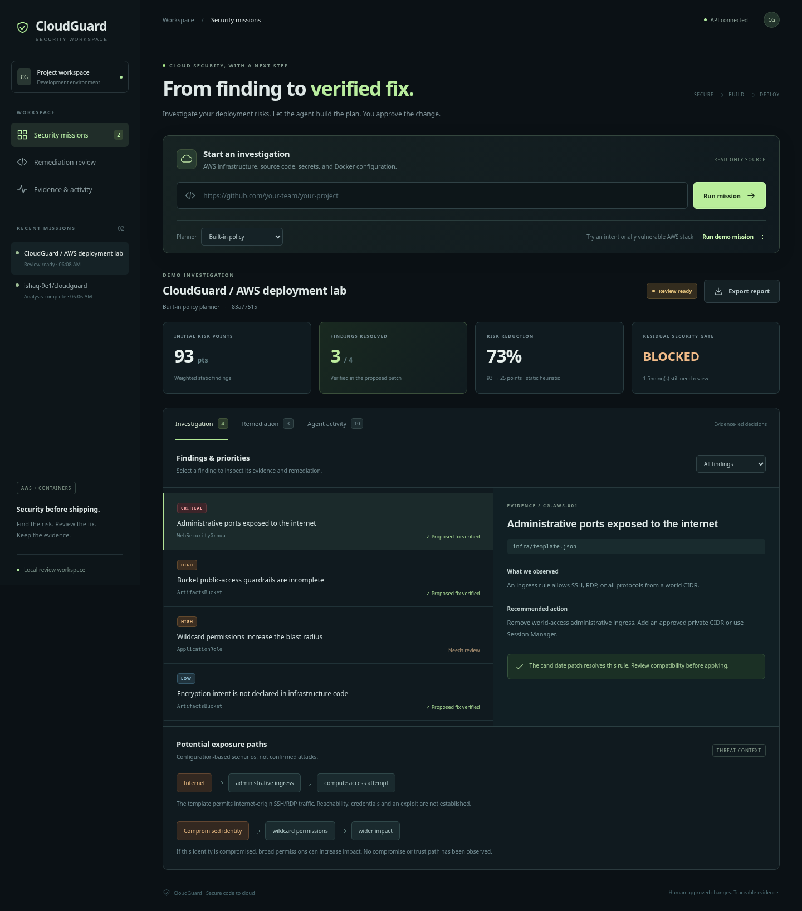
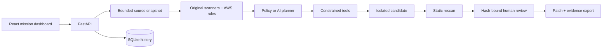

# CloudGuard

**Secure code to cloud: investigate deployment risks, stage a fix, verify it, and keep a human in control.**

CloudGuard extends the original GitHub security scanner and Docker readiness project with AWS security missions. The original scanners remain the foundation. The new workflow adds CloudFormation evidence, a bounded remediation agent, isolated verification, persisted audit history, and patch review.



## Run locally

Requires Python 3.12+, Node.js 22.12+ (tested with 24), npm, and Git. AWS credentials and Docker are not required for security missions.

```bash
bash scripts/setup.sh
bash scripts/start.sh
```

The API runs on port 8000 and the Vite dashboard on port 5173. Vite proxies `/api` to the backend. Run from the existing checkout; each Codex cloud task is already isolated, so a new worktree is unnecessary. `scripts/start.sh` starts local processes; they must restart in future tasks.

Windows: create `.venv` with `python -m venv .venv`, install `backend/requirements.lock`, run `python -m uvicorn backend.main:app`, then `npm ci` and `npm run dev` in `frontend` in another terminal.

## Try the demo

1. Click **Run demo mission**. The deliberately vulnerable AWS fixture is analyzed; it is never deployed.
2. Inspect four findings: public administrative ingress, incomplete S3 public-access controls, undeclared encryption intent, and wildcard IAM permissions.
3. Open **Remediation**. Three allowlisted fixes are staged and rescanned in an isolated copy. Static risk points fall from **93 to 25 (73%)**. IAM remains unresolved and the gate stays **BLOCKED**.
4. Review the diff and operational impact, check the review box, and approve. Export the patch or JSON evidence report.
5. Inspect **Agent activity** for every tool call, source digest, coverage, and approval record.

The score uses severity weights (40/25/10/3), not CVSS. These demo results are reproducible static-check outcomes, not cloud-security or exploitability measurements. Existing S3 default encryption is acknowledged; explicit encryption intent is a low-severity configuration recommendation.

For a real repository, enter an HTTPS GitHub URL. The mission clones its current default branch and records the exact commit. Read access uses existing Git authentication; the application does not need a token to scan a public repository. Missions never run package installs, Docker builds, or repository code.

## Agentic AI

The default **built-in policy planner is deterministic, not an LLM**. It provides a reliable offline demonstration of the same tool executor and verification workflow.

To use the model-driven planner, securely set `CLOUDGUARD_AI_KEY` in the backend environment, optionally set `CLOUDGUARD_AI_MODEL` (default `gpt-4.1-mini`), restart, and choose **AI agent**. Do not commit the key. The backend calls OpenAI at `api.openai.com` over verified HTTPS. Enable that destination in restricted environment settings if necessary. The AI receives finding metadata and recommendations, not source files or detected credential values. File paths and resource names are included.

The model chooses among three tools: `inspect_finding`, `stage_fix`, and `verify_patch`. Server-side validation enforces known finding IDs, inspection before staging, allowlisted JSON transformations, and a maximum of 20 model turns. The model cannot execute shell commands, write arbitrary files, approve changes, or deploy. Provider failures stop the mission with an explicit failure; they are not silently relabeled as successful AI runs.

## Supported scope and limits

- AWS CloudFormation JSON/YAML: inline security-group admin ingress, S3 public-access controls and encryption declaration, wildcard inline IAM permissions.
- Automated patches: literal, unconditional CloudFormation **JSON** resources for the three supported infrastructure fixes. YAML and IAM require manual changes. JSON is serialized with two-space indentation.
- Reused source checks: secret patterns, Python code patterns, and Dockerfile patterns. These are heuristic rules and can have false positives/negatives.
- Verification: rescans the proposed snapshot using the same rules; reports resolved, introduced, and remaining findings. It does not validate AWS semantics, runtime compatibility, or exploitability. Run CloudFormation validation and your application tests before deploying.
- No live AWS assessment, account-wide graph, Terraform evaluation, cloud deployment, or automatic pull-request creation is claimed. Exposure paths are clearly labeled conditional scenarios, not proven exploit chains.
- Mission source limits: 500 eligible files, 200 KB/file, 2 MB total; symlinks are not followed. Skipped eligible files and parse errors make analysis incomplete. Git clone has a 90-second timeout; very large repositories still need additional resource isolation in production.
- Dependency CVE audits are explicitly **not run in missions**. The legacy `/scan` route retains pip-audit with package execution disabled; unsupported/unpinned requirements can produce an error, which fails the security gate closed.
- The original Docker routes are disabled by default. `CLOUDGUARD_ENABLE_DEPLOYMENT=1` enables legacy trusted-local experiments only. They are not an authenticated cloud deployment service.

## Architecture



Mission records persist under `.cloudguard/` or `CLOUDGUARD_DATA_DIR`. They include findings and proposed diffs; protect this directory. Source checkouts for missions are temporary. GitHub sources are never pushed or modified by a mission. Demo fixtures are intentionally insecure and must not be deployed.

This is a **single-user local/hackathon application**. Approval is a local workflow event, not authenticated identity proof. Do not expose it directly to the internet. A production version needs authentication/authorization, isolated workers, durable job recovery, repository-size controls during clone, secret-store integration, retention policy, and independent infrastructure validation.

## Validation

```bash
.venv/bin/python -m unittest discover -s backend/tests -v
cd frontend
npm run build
npm run lint
```

Tests cover baseline readiness, AWS rule behavior, patch idempotency, preserved HTTPS ingress, symlink/size boundaries, failed analysis, tool restrictions, credential-value exclusion, approval hash validation, and gated downloads. See [the demo and presentation guide](docs/DEMO.md) for a three-minute walkthrough and accurate resume wording.

A built frontend can be served separately with `VITE_API_BASE_URL` set during the build, or behind a reverse proxy routing `/api` to the backend. The development proxy is not part of the static production bundle.
